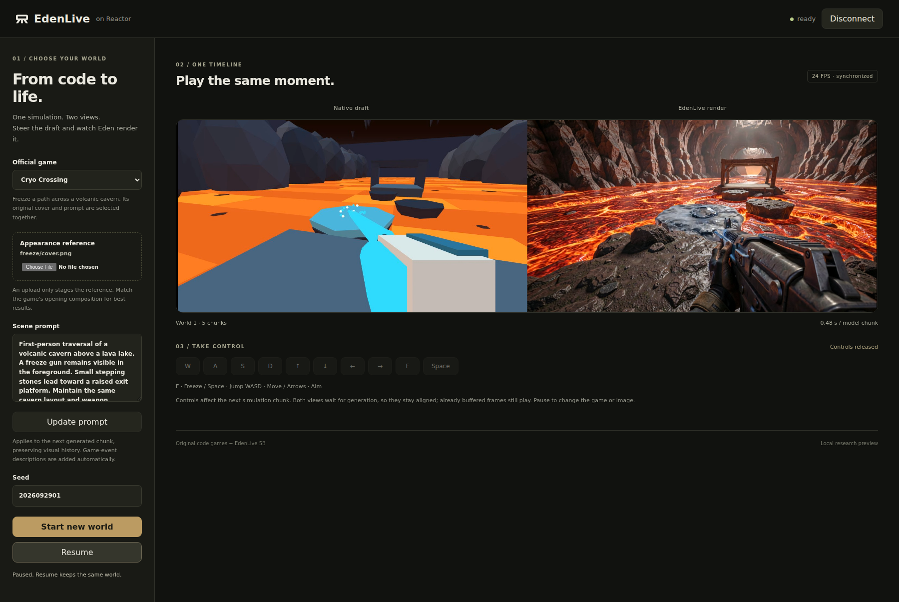

# EdenLive on Reactor

Reskin a draft video with EdenLive through [Reactor](https://reactor.inc). The draft comes
from one of EdenLive's code-driven games, steered with keyboard or on-screen controls, or
from your own video (a webcam, a screen, a canvas) sent on the `source_video` track. Choose
a game's original reference or upload your own, and switch the draft source at any time
with `set_source`. Every completed chunk streams EdenLive's render on `main_video` and the
draft it came from on `draft_video`, frame for frame. [`model_behaviour.md`](model_behaviour.md)
is the full contract.



*A recorded run of the earlier 24 FPS demo; the current playback controls are described below.*

This recipe uses [EdenLive's source](https://github.com/VAST-AI-Research/EdenLive) and
the 5B weights. Prepare them before startup; inference runs locally.

## What you need

- Linux, one NVIDIA B200, Docker and the NVIDIA Container Toolkit.
- About 37 GB for the 5B weights, plus space for the image and source.
- The compatible seven-game source snapshot below and access to `VAST-AI/EdenLive`.
- Node.js 20+ for the demo and the original games' JavaScript dependencies.

## 1. Prepare the source and weights

Install the current [Reactor CLI](https://docs.reactor.inc/deploy) and the Hugging Face CLI.
Prepare a directory on a disk with sufficient space:

```sh
export EDEN_BUNDLE=/path/to/edenlive-bundle
mkdir -p "$EDEN_BUNDLE"
git clone https://github.com/VAST-AI-Research/EdenLive.git "$EDEN_BUNDLE/source"
git -C "$EDEN_BUNDLE/source" checkout --detach 7499680ce87ee8b3b8ac4de1f3b360b0d78f1e12
npm --prefix "$EDEN_BUNDLE/source/realtime/games" install --ignore-scripts --no-package-lock
hf auth login
hf download VAST-AI/EdenLive --revision fc9ad921b7fab8fa6a82fe66071fe6d3bd55b429 \
  --include 'dit-5b/*' 'vae-5b/*' 'decoder-5b/*' 'umt5/*' 'vision-encoder/*' 'scheduler-5b/*' \
  --local-dir "$EDEN_BUNDLE/weights/EdenLive"
```

The source is pinned to the original seven-game layout used by this integration.
Newer upstream revisions rename or replace game registry entries, so the current
upstream checkout is not a drop-in replacement for this bundle. An existing compatible
source bundle can be reused instead.

The source bundle must contain `realtime/flashdreams`, `realtime/integrations_v2`,
and `realtime/games`. Its model implementations and game assets are used directly; the
timeline and unchanged host resources are imported from the same source. `capture/`
contains the renderer and host scripts that implement Reactor-specific capture and input handling.
Keep credentials out of source files and Docker build arguments.

## 2. Start the model

From this directory:

```sh
reactor build
reactor run --gpus device=0 --shm-size 2g --weights "$EDEN_BUNDLE" --port 8080
```

Choose a free GPU on a shared machine. The image is built from `reactor.yaml` and runs
Reactor Runtime 3.8.3. There is no separate Dockerfile. The model stays on one GPU;
the original game engine runs in headless Chromium, with GPU rendering enabled
on the same card.
Use a CLI version that supports `--shm-size` (tested with v1.20261014.332): Docker's
64 MiB default is too small for the full-resolution chunk exchange.

**Check:** `curl http://localhost:8080/health` reports `"state":"available"` after loading.
Leave the terminal running; `Ctrl+C` stops the service. Loading and the first chunk take
longer than subsequent chunks. The default B200 profile enables dense FlashAttention 4,
PyTorch compilation and the author's CUDA graph dispatch, and `warmup: true` pays the
compilation during load: the model generates throwaway worlds until every compiled shape and
CUDA graph exists, then forgets them; the application then plays a short session of every
game with no client (about 11 s), so a fresh process's first-time costs (browser launch,
each game's first captures) fall before the server reports available. A cold load takes about 110 s on a B200 (30 s of weights,
about 65 s of compilation); with the compile cache warm it is much shorter. The first session
then runs at steady-state speed.

To use the native eager profile, set `attention_backend: native`, `cuda_graph: false`
and `compile_model: false` in `edenlive.yaml`, then rebuild and restart. Both profiles
keep the same weights, four sampling steps, precision policy and history length.

The game capture has two switches in `edenlive.yaml`. `capture_format: raw` (default) reads
the canvas pixels exactly; `jpeg` restores the earlier JPEG-quality-0.8 drafts.
`draft_video: sparse` (default) renders and reads back only the frames the model conditions
on (every fourth), steps the game logic alone for the others, and repeats each read-back frame
in `draft_video` until the next, so the draft track updates at 6 Hz; `full` renders and reads
back every game frame. The conditioning is the same either way as long as a game's logic does
not read back from its render, which holds for all seven shipped games; use `full` for a game
that does, or when the client shows the draft at 24 fps
([`model_behaviour.md`](model_behaviour.md)).

## 3. Open the demo

The demo frontend is in `demo/`. It shows `draft_video` and `main_video` side by side:

```sh
cd demo
npm ci
VITE_REACTOR_URL=http://localhost:8080 npm run dev
```

Open the URL printed by Vite. In the header, pick where to connect: **Local** (the model
server URL, prefilled from `VITE_REACTOR_URL`), or **DEV** / **PROD** with your own Reactor
API key for that platform. This is a bring-your-own-key demo: never embed a team key in
the frontend or its build settings. A public service using an operator-owned key should
exchange it for short-lived session tokens on a backend.
Click **Connect**, choose a game, optionally
upload an **Appearance reference**, and press **Start**. Selecting or uploading alone
does not generate video. Match a custom reference to the game's opening composition.

For a remote GPU server, the browser must reach both HTTP and WebRTC. SSH forwarding
of the HTTP port alone does not carry video; host networking alone does not solve this.
Use a TURN-over-TCP relay and forward its TCP listener along with the frontend and HTTP
ports. Keep machine-specific relay credentials and network overrides outside this recipe.

`npm run build` writes a static site to `demo/dist/` that works from any static host;
[demo/DEPLOY.md](demo/DEPLOY.md) covers deploying it to Vercel.
The demo reads the original `realtime/games/` from the surrounding EdenLive repository,
or from `$EDEN_BUNDLE/source/` in Cookbook. `EDEN_GAMES_ROOT` can select a different
compatible games directory. Vite serves those files in development and includes them
in `dist/` for deployment. Game code and covers stay upstream; Three.js is installed
by `npm ci`.

## Controls and playback

| Control | Effect |
| --- | --- |
| Draft source (`set_source`) | `game` draws the draft from the selected game; `client` draws it from your `source_video` track, sent at any steady rate from 10 to 60 fps (24 is typical); the output then plays at that rate. Switch any time; the world keeps its history. |
| Official game | Stage one of seven original games with its matching cover and prompt. Pause before changing it. |
| Appearance reference | Stage a PNG, JPEG or WebP, up to 25 MiB / 16 megapixels. The image is resized and center-cropped to 1280 × 704 at Start. |
| Start / Start new world | Start the selected game and a fresh video with the chosen seed. |
| Keyboard / on-screen keys | Hold to move or act; release to stop that control. Available actions vary by game and are listed in the demo. |
| Mouse look (`set_look`) | A held turn and tilt rate, each -1..1, applied on every game frame until replaced; send (0, 0) when the mouse stops. It adds to the arrow keys and is limited to the game's own turn speed. Pause, a source switch, an outcome and the session's end reset it. |
| Update prompt | Change upcoming appearance text while keeping the same world. Native game-event descriptions are added automatically. |
| Pause / Resume | Hold both simulation and generation, then continue the same world. A prompt change while paused stays paused. |

The first chunk contains 9 frames; later chunks contain 12. Each completed chunk is
returned immediately. The native simulation advances at 60 Hz and is sampled at 24 FPS;
both 1280 × 704 output tracks play at `play_fps` (40 FPS by default, so the game runs 1.7× real speed; 24 plays it at real speed). Each draft/generated pair uses the same
simulation frame and timestamp, so neither track runs ahead of the other. When generation takes longer
than playback, both views wait together.

The demo polls held keys every 33 ms, with one command in flight and one replaceable
latest state. It does not replay old key transitions. The native renderer samples
the latest accepted state before each draft frame, and each chunk is captured when its
step asks for it, so a key reaches the next chunk. Pause freezes capture at a frame boundary;
Resume keeps any partially captured chunk and the same model history. Hold an action
long enough to be sampled: a press and release between samples is intentionally
coalesced. Already captured, generated or buffered frames retain their original input.
Runtime accepts commands between inference steps, so 33 ms polling is not a claim
of 33 ms input-to-video latency.

Prompt edits preserve video history and may change appearance gradually. They do not
rewrite the game geometry, controls, or objectives. A terminal game pauses generation;
press **Start new world** to begin again.

## Validation and current limits

Tested on one B200 with all seven games, a 13-chunk interactive rollout, ten keyboard
actions, live prompt edits, pause/resume and reconnect through TURN/TCP. A controlled
fixed-kernel comparison of the native pipeline and adapter model matched all 141 raw
RGB frames across 12 consecutive chunks. The native autotuned default has run-to-run
variation; that profile is not claimed to be bit-exact.

In a separate two-round, 32-chunk-per-round model benchmark, the default B200 profile
measured about **57.6 FPS** (0.208 s per 12-frame steady-state chunk), versus **25.8 FPS**
for the native eager profile. These timings include DINO conditioning, generation,
cache finalization, decoding and RGB transfer; they exclude game capture, transport,
warmup and prompt re-encoding. Playback is `play_fps`, **40 FPS** by default.
FA4 and compiler fusions change floating-point reduction order; this profile is not claimed to
produce bit-identical video. The raw-frame parity check above applies to the native
fixed-kernel profile.

The accelerated profile also passed a 13-chunk Cryo Crossing browser run with ten
controls, live prompt edits, pause/resume, reconnect and relay-only TURN/TCP.
Capture and inference use a bounded pipeline; both views display the same simulation
frames after inference completes.
End-to-end responsiveness includes capture, inference, transport and playback buffering.
Custom-reference quality and arbitrary long sessions still
need broader evaluation; the integration does not invoke the optional coding agent.

## Development

`edenlive_app.py` owns commands and the step; `edenlive_types.py` defines the client
contract. `edenlive_draft.py` defines the draft-source protocol and the client source;
`edenlive_game.py` is the game source. Both reach the model through one path, described in
[`model_behaviour.md`](model_behaviour.md) with the invariants to keep, and
[`PORTING.md`](PORTING.md) records the port's decisions. `edenlive_model.py` and `edenlive_backend.py` own the original model pipeline
and its streaming state. The application entrypoint uses an `_app` suffix to avoid
shadowing the upstream `edenlive` package.

This recipe uses the author's 5B LightTAE real-time pipeline with four sampling steps
and its original history and cache update rules. `edenlive_attention.py` supplies the
single-GPU dense FA4 implementation; compilation preserves explicit precision casts,
and graph capture follows the author's cache-aware dispatch. Multi-GPU serving is not
implemented.

CPU tests require Runtime, Pillow, psutil, loguru, pytest and pytest-asyncio; no weights, upstream checkout
or GPU are needed:

```sh
PYTHONPATH=. python -m pytest tests/ -q --asyncio-mode=auto
python -m reactor_runtime.schema --path .
reactor validate
```

## Credits

EdenLive's model, game engine and assets are provided by its authors. Thanks to
[Rising0321](https://github.com/Rising0321), Zian (Andy) Zheng, and
[Davide Locatelli](https://github.com/Dere-Wah) for the Reactor port, synchronized demo,
and inference infrastructure. The integration is maintained in
[reactor-team/reactor-edenlive](https://github.com/reactor-team/reactor-edenlive).
Source and checkpoints remain subject to their respective licenses and access terms.
